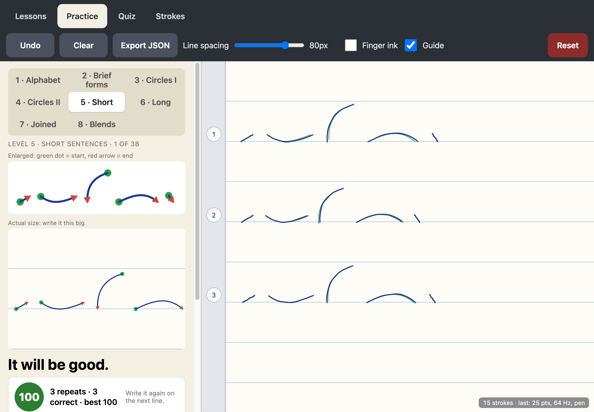
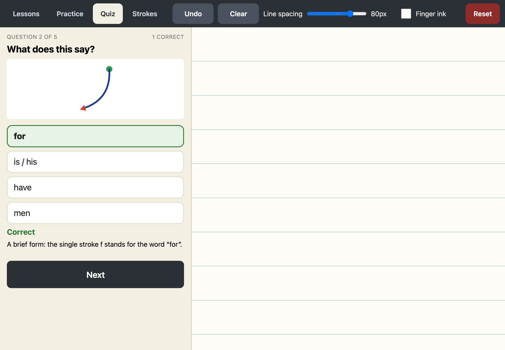
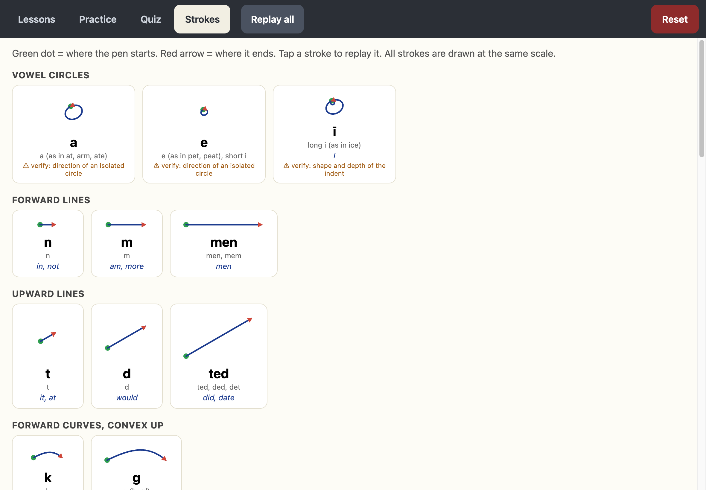
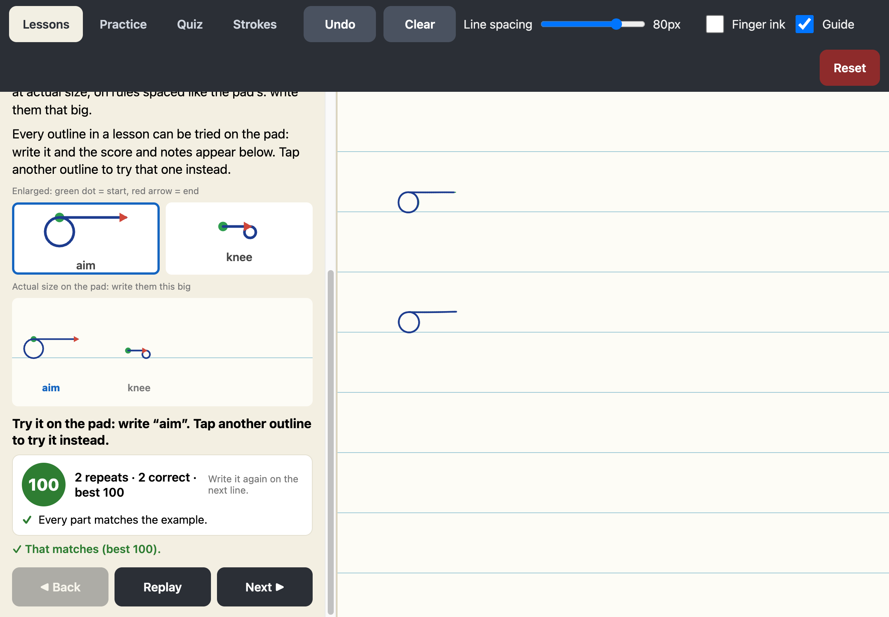
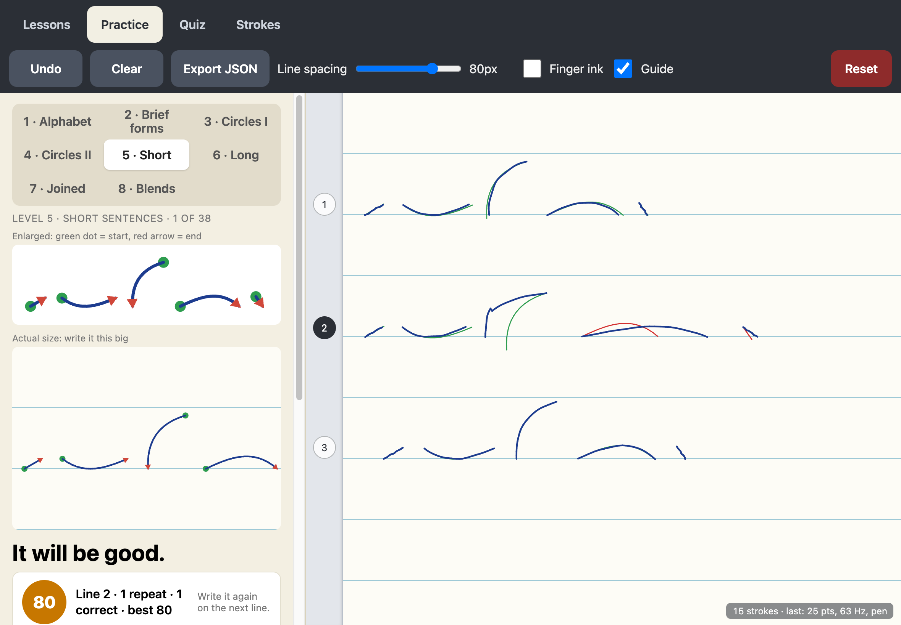

# Gregg Trainer

A browser app for practising Gregg shorthand by hand. You copy an outline onto a ruled pad with an Apple Pencil (or a mouse), and the app compares your pen path with the model outline and tells you what is off: wrong slant, wrong length, wrong curve, a circle turning the wrong way or sitting on the wrong side. It is designed for an iPad but runs in any modern browser. There is no build step and no runtime dependencies.



## Features

- Four views: Lessons, Practice, Quiz and Strokes.
- Step-by-step lessons for Units 1–3 of the 1929 manual: read each rule, watch its outlines, write them on the pad until they pass, and name outlines by sight.
- Eight levels of examples: alphabet strokes, brief forms, two levels of circle words, short sentences, long sentences, joined words (Unit 2) and blends with the frequent-word drill (Unit 3).
- Write the same example many times; every repeat is scored separately, with a running count, best score and recurring problems.
- Per-line statistics: once you have written two or more lines, numbered buttons on the pad show the stats for one line.
- A real-time guide: a faint preview of the next outline, live warnings while you write, and a green/red overlay showing the model under what you wrote.
- Quiz with read, write and look-alike-series questions, with the last results kept locally.
- Stroke gallery with every stroke animated in its writing direction.
- The app learns your natural writing size, so short and long strokes (t/d, k/g, n/m) are judged against how big you write.
- Export an attempt as JSON.
- Pen-only ink by default (palm rejection); finger ink can be turned on.

## Quick start

Requirements:

- A modern browser (it uses ES modules, pointer events, canvas and localStorage).
- Node.js 22 or newer for the dev server and tests. The unit tests only use `node:test`; the end-to-end script uses the global `WebSocket`, which Node provides without a flag from version 22.

```text
npm start
```

This runs `node --watch tools/dev-server.mjs` and prints a local URL (default `http://localhost:8000/`). The dev server serves `app/`, reloads open pages when any file under `app/` changes (strokes on the pad survive a reload), and answers `/api/quiz`.

Environment variables: `PORT` (default `8000`) and `HOST` (default `0.0.0.0`).

The app is static, so any static file server pointed at `app/` also works. Quizzes do not depend on `/api/quiz`: if the request fails, the browser generates the quiz itself with the same code (`app/js/quizgen.js`). You lose live reload only.

### Using it on an iPad over the LAN

1. Put the computer and the iPad on the same network.
2. Run `npm start`. Besides the local URL, the server prints a `LAN:` URL for each non-internal IPv4 address.
3. Open that URL in Safari on the iPad.

Security note: by default the dev server listens on all network interfaces and has no authentication, so anyone on the same network can load the app. It serves only the contents of `app/`, but you should not run it on an untrusted network. To restrict it to the local machine:

```text
HOST=127.0.0.1 npm start
```

## How to use it

### Views

- **Lessons** (`#learn`): shares the pad. One tab per unit of the manual (Units 1–3), each a sequence of steps. A *read* step quotes a rule and animates its outlines enlarged (tap a figure to replay it), then shows the same outlines at actual size on rules spaced like the pad's, so you can see how big to write them. Every outline a lesson shows can be tried on the pad: tap it (enlarged or actual size) and what you write is scored and drawn over the model in green and red, as in Practice; each outline keeps its own ink while the step is open. A *write* step shows an example to copy and scores the pad like Practice; a repeat scoring 80 or more passes it. A *choose* step shows an outline and asks what it says; a wrong pick can be retried, and once it is answered the outline is shown at actual size to try on the pad. Steps can be skipped; each tab shows how many exercises are done, and the unit summary lists the skipped ones. Progress is kept in localStorage; the strokes written in a lesson are not.
- **Practice** (`#pad`, the default): the left panel shows the example to copy, enlarged and at actual size on ruled lines, with its meaning and source. Pick a level from the tabs, move with Prev/Next (or the left and right arrow keys), and use Replay to watch the stroke order. Write on the pad on the right.
- **Quiz** (`#quiz`): shares the pad. Choose the length (5, 10 or 20 questions), the levels and the question types, then answer. Read questions ask what an outline says (four choices). Write questions ask you to write a word, letter or sentence and score it. Look-alike series ask you to write each member of a family of similar strokes (for example n, m or t, d) and show the results at the end. Passing is a score of 80 or more. The last 20 results are kept.
- **Strokes** (`#strokes`): every stroke family at one scale. A green dot is where the pen starts and a red arrow is where it ends. Tap a stroke to replay it, or use Replay all.

| Quiz | Strokes |
| --- | --- |
|  |  |



### Toolbar (Practice)

- **Undo**: removes the last stroke (or restores a cleared pad). Cmd/Ctrl+Z does the same.
- **Clear**: clears the pad for the current example. It can be undone.
- **Export JSON**: saves the current attempt (see below). On an iPad the share sheet is used when available; otherwise the browser downloads a file named `gregg-<example id>-<timestamp>.json`.
- **Line spacing**: 32 to 96 px, default 48. The example is redrawn at the same scale.
- **Finger ink**: by default only the pen and the mouse draw. Turn this on to draw with a finger.
- **Guide**: turns the real-time guide (preview and live warnings) on or off (on by default).
- **Reset** (all views): after a confirmation, deletes everything the app has stored: practice strokes and scores, quiz history, export marks, settings and the learned writing size.

### Repeats

Write the example several times on the same pad. For letters, each stroke is one repeat, so write the letter again and again along a line. For everything else (brief forms, words, sentences), each line of writing is one repeat, so write the example again on the next line. Each repeat is scored separately. The panel shows the number of repeats, how many scored 80 or more, the best score, and the average score as the main number. Problems that show up in two or more repeats are called out.

### Statistics for one line

When the pad holds two or more lines of writing, a numbered button appears next to each line in a left column of the pad. Tap a number to see the score and critiques for that line only. Tap the same number again to go back to all lines. Changing to another example clears the pick.



### Guide

With Guide on, the app shows a faint outline of the next part to write once the pen has clearly moved, and warns while you are still writing (wrong starting direction, circle turning the wrong way, stroke running long).

Whether Guide is on or off, the app adds a short note after each stroke and draws the correct shape thinly under what you wrote: green where it matches, red where it does not.

## Testing

Install the dev dependency (c8, used only for coverage) once:

```text
npm install
```

```text
npm test
```

Unit tests, run with `node:test`. They cover scoring, repeat grouping, joining and rendering geometry, example data and quiz generation.

```text
npm run test:e2e
```

An end-to-end run in headless Chrome that drives the real page with synthetic pen input. It needs Google Chrome and `python3` (it serves `app/` with `python3 -m http.server`). Set the `CHROME` environment variable to the Chrome executable if it is not at the default macOS location, `/Applications/Google Chrome.app/Contents/MacOS/Google Chrome`.

```text
npm run coverage
```

Runs the unit tests and the Chrome test together and writes a merged coverage report with c8 into `coverage/`. It fails if line coverage across `app/js/` and `app/data/` drops below 80%.

```text
npm run screenshots
```

Regenerates the README screenshots in `docs/screenshots/` by writing on the pad in headless Chrome. It has the same requirements as the end-to-end test.

## Project layout

```text
app/
  index.html          single page: three views and the toolbar
  css/app.css         styles
  js/
    main.js           wiring: routing, toolbar, persistence, export, per-line pickers
    ink.js            InkPad: pointer capture, ink drawing, undo, JSON (de)serialisation
    assess.js         scores an attempt against the model outline; writes critiques
    repeats.js        groups pad strokes into repeats and lines; aggregates scores
    assist.js         real-time guide, live warnings, green/red check overlay
    practice.js       the example panel (art, meaning, score, critiques)
    lessons.js        the Lessons view (Units 1–3, step by step)
    quiz.js           quiz UI and history
    quizgen.js        seeded quiz generation (no DOM)
    render.js         stroke primitives to Bezier geometry, SVG and animation
    join.js           joins strokes, vowel circles and the h dot into outlines
    writer.js         learned writing-size scale
    gallery.js        the Strokes view
  data/
    strokes.js        the stroke table (geometry in U) and look-alike families
    examples.js       the eight levels of examples
    lessons.js        the lesson steps for Units 1–3
tools/
  dev-server.mjs      static server for app/ with live reload and /api/quiz
  coverage.mjs        runs unit + Chrome tests under c8 (npm run coverage)
  screenshots.mjs     regenerates docs/screenshots/ (npm run screenshots)
tests/                unit tests (*.test.mjs), the Chrome end-to-end script
                      (inkpad.cdp.mjs) and fixtures
docs/
  ARCHITECTURE.md     module map, data flow, formats
reference/            transcriptions of the manual's Units 2 and 3 and stroke-geometry notes
  screenshots/        images used in this README
```

See [docs/ARCHITECTURE.md](docs/ARCHITECTURE.md) for how the pieces fit together.

## Data and privacy

Everything stays in your browser's localStorage. Nothing is sent anywhere: the app makes no network requests except to load its own files from the server you started (and, with the dev server, `/api/quiz`). Export is user-initiated; the exported file contains your strokes and, among other fields, the browser's user-agent string. Reset removes all stored data.

## Credits

Outline forms and the rules for joining circles follow the *Gregg Shorthand Manual, Anniversary Edition* (1929). Brief forms come from the Gregg Simplified chart. Each example lists its source in the app.

The manual is in the US public domain. The scan used to transcribe Units 1–3 (see `reference/`) was downloaded from [greggshorthand.github.io](https://greggshorthand.github.io) ([Annivman.pdf](https://greggshorthand.github.io/Annivman.pdf)). The PDF itself is not included in the repository.

## License

MIT. See [LICENSE](LICENSE).
